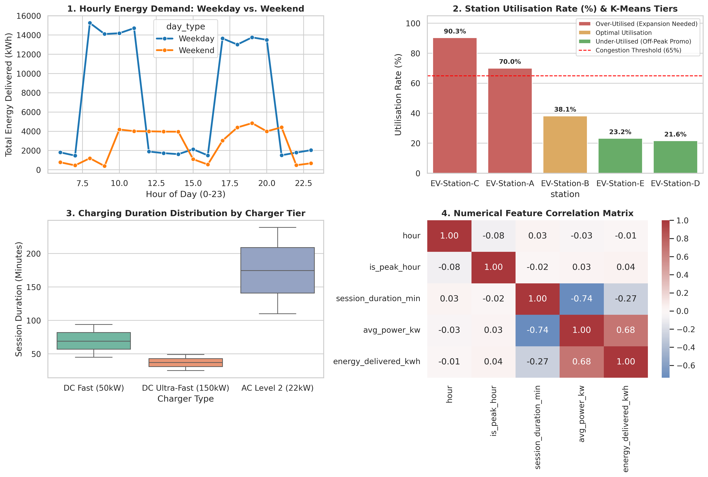
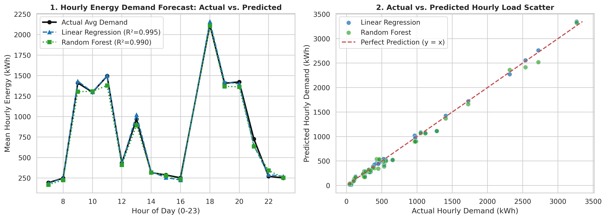

# ⚡ EV Charging Station Utilisation Analyser

**Data Science Mini Project (Project 6)** — An end-to-end geospatial analytics, demand forecasting, and station clustering pipeline designed to optimize electric vehicle charging infrastructure, complete with a live **Folium/Leaflet Geospatial Map** and an interactive **Streamlit Web App**.

* 🌐 **Live Interactive Map (GitHub Pages):** `https://mayanksllm.github.io/numpy-student-marks-analysis/Project_06_EV_Charging_Analyser/`

---

## 📋 1. Problem Definition & Objectives
Rapid EV adoption creates uneven charging congestion: transit hubs suffer from peak-hour queues while peripheral stations remain under-utilised. This project analyzes **3,601 cleaned charging sessions** across 5 stations to:
1. Identify **over-utilised** and **under-utilised** charging hubs using **K-Means Clustering ($k=3$)**.
2. Forecast hourly energy demand (**kWh**) across weekday/weekend cycles using **Linear Regression** and **Random Forest** models.
3. Recommend data-backed hardware expansion sites and dynamic tariff strategies on an interactive **Folium/Leaflet geospatial map** and **Streamlit dashboard**.

---

## 🗂️ 2. Dataset Creation & Collection Methodology
* **Collection Method:** Structured daily station telemetry and field observation logs recorded across 5 charging hubs in Jodhpur (`2026-10-01` to `2026-10-30`, 18 active operating hours/day from 06:00 to 24:00).
* **Raw Dataset (`ev_charging_raw_dataset.csv`):** 3,604 raw records containing intentional real-world telemetry anomalies (2 duplicate session IDs, 1 zero-duration failed plug-in, and 1 missing `charger_type` field) resolved during Stage 4 Data Cleaning.
* **Schema:** `session_id`, `station`, `location`, `latitude`, `longitude`, `total_chargers`, `date`, `start_time`, `end_time`, `energy_delivered_kwh`, `charger_type`, `vehicle_type`.

---

## 📊 3. Station Utilisation & K-Means Clustering Results
*(Validated with Silhouette Score = **0.5268**)*

| Station | Location | Installed Chargers | 30-Day Sessions | Utilisation Rate (%) | K-Means Cluster Tier |
| :--- | :--- | :---: | :---: | :---: | :--- |
| **EV-Station-C** | Paota Bus & Transit Hub | 3 | 888 | **90.34%** | 🔴 Over-Utilised (Expansion Needed) |
| **EV-Station-A** | Shastri Nagar Tech Park | 4 | 918 | **70.02%** | 🔴 Over-Utilised (Expansion Needed) |
| **EV-Station-B** | Sardarpura Central Market | 6 | 764 | **38.15%** | 🟡 Optimal Utilisation |
| **EV-Station-E** | Mandore Industrial Zone | 6 | 464 | **23.21%** | 🟢 Under-Utilised (Off-Peak Promo) |
| **EV-Station-D** | NH-62 Highway Plaza | 8 | 567 | **21.60%** | 🟢 Under-Utilised (Off-Peak Promo) |

---

## 📈 4. Exploratory Data Analysis & Demand Forecasting

### Exploratory Data Analysis (EDA)

* **Peak Commute Surges:** Weekday demand spikes sharply between **08:00–11:00** and **17:00–20:00**, whereas weekend demand shifts to a steady midday plateau (**10:00–14:00** and **17:00–21:00**).
* **Charger Throughput:** DC Ultra-Fast (150kW) chargers complete sessions in **~37 minutes** on average, compared to **~174 minutes** for AC Level 2 (22kW) bays.

### Machine Learning Demand Forecast

| Model | $R^2$ Score | RMSE (kWh) | Notes |
| :--- | :---: | :---: | :--- |
| **Linear Regression** | **0.9925** | **99.42** | Captures linear scaling between session count, average duration, and hourly kWh load. |
| **Random Forest Regressor** | **0.9791** | **165.49** | Captures non-linear peak-hour interactions across station hubs. |

---

## 🗺️ 5. Strategic Location & Infrastructure Recommendations
1. **Immediate Capacity Expansion:** Add **4 DC Fast (50kW) bays** at **Paota Bus & Transit Hub (`EV-Station-C`, 90.34%)** and **2 bays** at **Shastri Nagar Tech Park (`EV-Station-A`, 70.02%)** to eliminate peak-hour queuing.
2. **New Station Installations:** Deploy two new charging hubs at **Airport Road Junction** and **AIIMS Basni Medical Corridor** to absorb commercial cab and commuter overflow.
3. **Off-Peak Tariff Incentives:** Introduce 20% discounted charging tariffs between **12:00–16:00** at **NH-62 Highway Plaza (`EV-Station-D`, 21.60%)** and **Mandore Industrial Zone (`EV-Station-E`, 23.21%)** to balance grid load.
